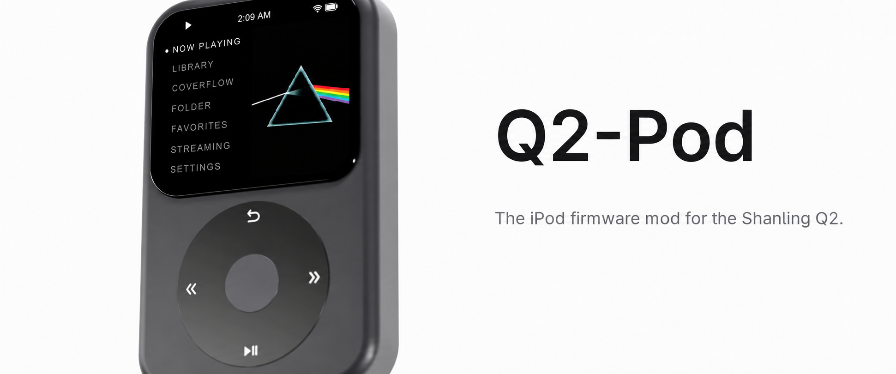

  

  iPod classic experience for the Shanling Q2. 
  Wheel navigation, Coverflow, PEQ, and optional Spotify Connect and Rockbox, all built on top of the stock firmware.

  
  
  
  
  

  <b><a href="https://github.com/DiamondBond/q2-pod/releases/latest">Download</a></b> ·
  <b><a href="#install">Install</a></b> ·
  <b><a href="https://github.com/DiamondBond/q2-pod/releases/latest/download/Q2-Pod-User-Guide.pdf">User guide</a></b> ·
  <b><a href="docs/changelog.md">Changelog</a></b>

## Features

- **iPod UI:** Home, menus, Now Playing, Coverflow and four visualizers. Choose your accent colour, Home layout and battery display.
- **Wheel navigation:** smooth scrolling, and menus remember your place.
- **EQ:** Simple's Low, Mid and High sliders, or Advanced's parametric EQ with up to 30 bands and a live curve. Import AutoEQ and Equalizer APO presets.
- **Streaming:** Spotify Connect (Premium), AirPlay from your iPhone, and Internet Radio.
- **Scrobbling:** send your listens to Last.fm or ListenBrainz over Wi-Fi.
- **Ratings:** rate songs and albums 0–5 hearts, then browse Top Rated, Loved and rated albums.
- **Browsing and playback:** favourites, playlists, Most Played, Long Songs, Crossfade, and shuffle by song, album or folder.
- **Podcasts and audiobooks:** `.m4b` audiobooks (including ones split by a CUE sheet) and podcasts resume where you stopped, with per-folder playback speed.
- **AirPods:** stem controls, ear detection and two-way volume sync.
- **Battery:** an optional 80% charge limit and Low Power mode.

<h2>Screenshots</h2>

  
  &nbsp;
  

## Install

**Requirements:** Q2 with microSD card and USB-C cable.

> [!IMPORTANT]
> Charge the Q2 before you start. Only insert or remove the microSD card while the Q2 is **fully shut down** (not asleep), or the card can be corrupted.
>
> Flashing firmware carries risk. Back up anything on the card you can't lose before you start.

1. **Download** `Q2.Firmware.*.zip` from the [latest release](https://github.com/DiamondBond/q2-pod/releases/latest).
2. **Plug the Q2 into your computer** with the USB-C cable. The card shows up as a drive.
3. **Unzip the download** and copy `update.tar` to the **root** of the card (not inside a folder), then eject and unplug.
4. **Update:** open **System settings → System Update → TF card update**. Leave the card in until the Q2 restarts.

> [!TIP]
> Prefer Shanling's original look? Download `Q2.Firmware.*-legacy.zip` instead. It has the same features and fixes, without the iPod UI.

## Extras

- **Spotify Connect:** unzip `q2-librespot-*.zip` from [q2-librespot's latest release](https://github.com/DiamondBond/q2-librespot/releases/latest) to the card's root. Then open **Streaming → Spotify** on the Q2 and pick it in the Spotify app. [More](https://github.com/DiamondBond/q2-pod/releases/latest/download/Q2-Pod-User-Guide.pdf).
- **Scrobbling:** connect Last.fm or ListenBrainz with the [user guide](https://github.com/DiamondBond/q2-pod/releases/latest/download/Q2-Pod-User-Guide.pdf).
- **Lock screen:** six built-in wallpapers, a large clock, or your own images ([user guide](https://github.com/DiamondBond/q2-pod/releases/latest/download/Q2-Pod-User-Guide.pdf)).
- **Boot logo:** put your own JPEG at `/Q2Pod/boot/boot-logo.jpg` on the card. It shows from the next power-on ([user guide](https://github.com/DiamondBond/q2-pod/releases/latest/download/Q2-Pod-User-Guide.pdf)).
- **Rockbox:** unzip [`rockbox.zip`](https://github.com/DiamondBond/q2-rockbox/releases) to the card's root. Hold Play/Pause while powering on to use Q2 Pod for that session. See the [setup guide](docs/setup.md) and [ported themes](https://github.com/DiamondBond/q2-rockbox-themes/releases).

## Controls

| Control             | Action                                                             |
| ------------------- | ------------------------------------------------------------------ |
| **Wheel**           | Scroll. Spin faster to speed up. Adjust a slider when one is open. |
| **Centre**          | Open the selected item. Double-press to turn the screen off.       |
| **Hold Play/Pause** | Track, queue, playlist and shuffle/repeat options.                 |
| **Hold Return**     | Jump to Now Playing; hold again to go back.                        |

The user guide covers every control, EQ, Coverflow and more tips.

## Library

Copy your music to the card over USB-C, then run **Library → Update Local Music** on the Q2.

These folders at the card's root each add their own Library entry: `Podcasts/`, `Audiobooks/`, `Photos/`, `Books/`, `Videos/`, and `EQ/` for EQ presets. See the user guide for supported formats.

Settings, play counts, ratings and resume points are stored on the Q2 itself, so they stay put when you swap cards.

## Updating

Repeat the [install steps](#install) with the newest release. Your settings, ratings and play counts are kept. The updater skips a version that's already installed, so a newer release always goes on.

## Restoring stock firmware

- **Back to Shanling's firmware:** install the [official Shanling firmware](https://en.shanling.com/download/150) the same way.
- **If the Q2 won't start up:** copy the `recovery-update` folder from [Shanling's recovery package](https://drive.google.com/file/d/1aINQfJu6n0JTQ4hOzzD1uSpSj3TS_NJj/view?usp=drive_link) to the card, then hold **Previous** and power on with **Centre**.

## Help

- **Question or suggestion?** Please join the [Discord](https://discord.gg/pgsQpXhSQ).
- **Bugs:** Please [open an issue](https://github.com/DiamondBond/q2-pod/issues).

## Documentation

- **For users:** [User guide](https://github.com/DiamondBond/q2-pod/releases/latest/download/Q2-Pod-User-Guide.pdf) · [Setup](docs/setup.md) · [Changelog](docs/changelog.md)
- **For developers:** [Building](docs/building.md) · [Releasing](docs/releasing.md) · [Internals](docs/internals.md) · [Remote control (dev builds)](docs/remote.md)

## License

[MIT](LICENSE) covers this repository's code and docs. The Shanling firmware included in release images remains Shanling's. Q2 Pod is an independent project and is not affiliated with Shanling.
